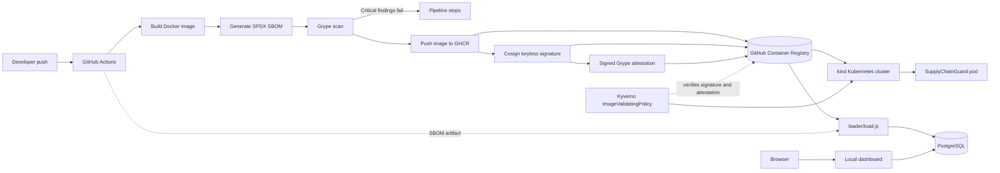

# SupplyChainGuard architecture

## System overview

## Components and trust boundaries

| Component | Responsibility | Trust boundary |
|---|---|---|
| GitHub Actions | Builds, scans, publishes, signs, and attests the image | GitHub-hosted CI and OIDC |
| Dockerfile | Defines the runtime image and non-root application user | Build input |
| Syft/Grype | Produces the SBOM and vulnerability result | CI tooling |
| GHCR | Stores immutable image digests and OCI metadata | External registry |
| Cosign/Sigstore | Records keyless signatures and attestations | External transparency/signing services |
| kind/Kubernetes | Runs the workload locally | Local cluster |
| Kyverno | Rejects unsigned or disallowed images | Cluster admission |
| Loader | Imports verified build metadata | Local CLI and database writer |
| PostgreSQL | Stores builds, components, vulnerabilities, and signatures | Local data service |
| Dashboard | Displays stored build data | Local unauthenticated HTTP service |

The image digest is the identity used across the pipeline. Tags are only
convenience references; admission and loading should use the digest returned
by the successful push.

